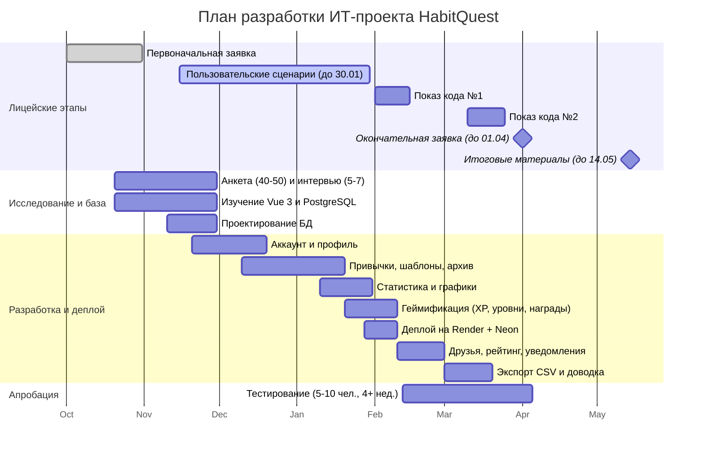

# Заявка на ИТ-проект «HabitQuest»

**ФИО:** Петров Кирилл  
**Кураторская группа:** [укажите группу 10 класса, например 10И1]  
**Электронная почта:** [укажите почту]  
**Telegram:** [@укажите_ник]

**Тема проекта:** HabitQuest — веб-сервис для формирования полезных привычек с элементами геймификации.

---

## 1. Проблемное поле

### Контекст

Формирование полезных привычек — регулярных действий, связанных со здоровьем, режимом дня и учёбой (зарядка, чтение, соблюдение режима сна, регулярная подготовка к занятиям), — требует систематического повторения на протяжении нескольких недель и месяцев. Основными акторами, которые стремятся выработать такие привычки, являются школьники 13–17 лет, студенты 18–22 лет и молодые специалисты 22–30 лет.

### Трудности, с которыми сталкивается пользователь

- **Отсутствие видимого промежуточного результата.** Человек прикладывает усилия каждый день, но реальный эффект от привычки отложен на месяцы. Из-за того что ежедневные шаги никак не фиксируются, возникает ощущение отсутствия прогресса.
- **Невозможность удержать регулярность.** При высокой учебной или рабочей нагрузке человек пропускает один день, затем второй, и после нескольких пропусков полностью прекращает выполнение привычки (чаще всего в первые 2–3 недели).
- **Большие затраты усилий на ручной самоконтроль.** Необходимость постоянно держать в голове расписание привычек и самостоятельно отслеживать выполненные дни быстро утомляет.
- **Отсутствие внешней опоры и обратной связи.** Рядом нет инструмента или окружения, которые своевременно напоминали бы о запланированном действии и показывали, сколько дней подряд удалось продержаться и в какой момент произошёл срыв.
- **Потеря мотивации из-за однообразия.** Монотонные ежедневные действия быстро надоедают, особенно подросткам и студентам, которым важны ощущение достижения и соревновательный элемент.

### К чему это приводит

- человек бросает начатую привычку и возвращается к прежнему образу жизни;
- повторные неудачи снижают уверенность в собственных силах и желание пробовать снова;
- потраченные время и усилия не приводят к закреплению результата;
- откладываются важные изменения в здоровье, режиме дня и учебной дисциплине.

### Способы обоснования проблемного поля

1. **Количественное исследование** — онлайн-анкетирование (Google Forms), планируемый объём выборки — 40–50 респондентов из трёх целевых групп, 10–12 вопросов (опыт формирования привычек, длительность удержания, причины срывов, использование трекеров и ожидания от инструментов поддержки).
2. **Качественное исследование** — полуструктурированные интервью с 5–7 представителями целевой аудитории, 8–10 вопросов (разбор личного опыта формирования привычки, ситуаций срыва и факторов, помогающих сохранять регулярность).

На этапе первоначальной заявки исследование ещё не проведено, поэтому числовые показатели распространённости проблемы не приводятся как установленные факты и будут зафиксированы по итогам анкетирования и интервью.

---

## 2. Заказчик или целевая аудитория

Заказчик отсутствует; продукт разрабатывается для широкой целевой аудитории, разделённой на три конкретные социальные группы:

### Группа 1. Школьники 13–17 лет
Учатся в 7–11 классах, совмещают школу, кружки и подготовку к ОГЭ/ЕГЭ. Самоконтроль ещё формируется, а свободного времени мало. Эта группа наиболее восприимчива к игровым механикам (очки, уровни, достижения), но быстро отказывается от перегруженных и сложных в настройке интерфейсов.

### Группа 2. Студенты 18–22 лет
После перехода из школы в вуз сталкиваются с резким снижением внешнего контроля и необходимостью самостоятельно выстраивать режим сна, учёбы и спорта. Для них важны наглядная статистика прогресса и возможность сравнивать свои результаты с друзьями.

### Группа 3. Молодые специалисты 22–30 лет
Работают полный день и испытывают дефицит времени и сил после работы. Им критичны быстрый доступ через браузер с любого устройства без установки приложений, простота отметки действий и своевременные напоминания.

---

## 3. Аппаратные и программные требования

Продукт представляет собой веб-сервис и работает в браузере пользователя (серверная часть и база данных размещаются на облачном хостинге).

### Минимальные аппаратные требования к клиентскому устройству

| Параметр | Минимальное требование |
|---|---|
| Процессор | двухъядерный, с тактовой частотой от 1,6 ГГц |
| Оперативная память | от 4 ГБ |
| Свободное место на накопителе | от 500 МБ (для работы ОС и кэша браузера) |
| Видеокарта | встроенная, с поддержкой аппаратного ускорения браузера |

### Минимальные программные требования

| Параметр | Минимальное требование |
|---|---|
| Операционная система | Windows 10, macOS 11, Linux (актуальные дистрибутивы); для мобильных устройств — Android 8.0, iOS 14 |
| Веб-браузер | Google Chrome 100+, Яндекс Браузер 23+, Mozilla Firefox 100+, Safari 15+ |
| Подключение к сети | стабильный доступ в интернет |

---

## 4. Функциональные требования

Ниже перечислены 11 содержательных функциональных требований (подробная последовательность действий пользователя описана в пользовательских сценариях):

1. **Работа с аккаунтом:** регистрация, вход, восстановление пароля по одноразовой ссылке и редактирование параметров профиля (имя, описание, цвет аватара).
2. **Создание привычки с настраиваемым расписанием:** выбор периодичности (ежедневно, по будням, выбранные дни недели или заданное число раз в неделю), названия, описания, иконки и цвета.
3. **Отметка выполнения привычки:** фиксация выполнения за текущий день и отмена отметки.
4. **Просмотр статистики с графиками:** отображение сводных показателей и графиков выполнения за выбранный период (7, 14 и 30 дней).
5. **Расчёт серий (streaks):** автоматический подсчёт текущей непрерывной серии и лучшей серии за всё время по каждой привычке.
6. **Система геймификации (XP, уровни и достижения):** начисление очков опыта за выполнение привычек, повышение уровня, отображение прогресса до следующего уровня и выдача достижений за ключевые события.
7. **Готовые шаблоны привычек:** создание новой привычки на основе предзаполненных популярных шаблонов.
8. **Друзья и соревнование:** поиск пользователей, отправка и принятие заявок в друзья, общий рейтинг по XP и просмотр прогресса друзей.
9. **Напоминания и уведомления:** настройка времени напоминания для привычки, внутренние уведомления о невыполненных привычках, заявках в друзья и полученных достижениях.
10. **Экспорт статистики в CSV:** выгрузка истории выполнений и сводных показателей по привычкам в файл формата CSV (UTF-8).
11. **Редактирование и архивация привычек:** изменение параметров существующей привычки, перенос неактуальных привычек в архив и возврат их обратно в активный список.

*Примечание:* переключение светлой и тёмной темы интерфейса реализовано как пользовательская настройка (свойство продукта) и не выделяется в отдельное функциональное требование.

---

## 5. Похожие / аналогичные продукты

### 1. Habitica ([habitica.com](https://habitica.com))
Трекер привычек с полноценной RPG-системой: персонаж, классы, экипировка, квесты и штрафы за пропуски.
- **Недостатки:** интерфейс перегружен сложными игровыми механиками, что повышает порог входа и отвлекает от самих привычек; часть возможностей и косметических элементов доступна только по платной подписке; русская локализация поддерживается сообществом через [Weblate](https://translate.habitica.com/projects/habitica/) и может содержать неполные или устаревшие переводы отдельных разделов.

### 2. Todoist ([todoist.com](https://todoist.com))
Популярный таск-менеджер, включающий систему геймификации [Karma](https://www.todoist.com/help/todoist/features/introduction-to-karma-OgWkWy) (очки, уровни и дневные/недельные серии за выполнение поставленных целей по задачам).
- **Недостатки:** продукт спроектирован для управления задачами, а не регулярными привычками — привычки приходится вести как повторяющиеся задачи, при этом система Karma считает общую активность по всем задачам, но не ведёт отдельную серию и статистику регулярности по каждой конкретной привычке; отсутствуют шаблоны привычек и социальный рейтинг друзей по привычкам; расширенные функции (включая напоминания) требуют платной подписки.

### 3. HabitNow / HabitBull
Специализированные мобильные трекеры привычек с календарём отметок и напоминаниями.
- **Недостатки:** отсутствуют игровые механики мотивации (очки опыта, уровни, достижения) и социальное взаимодействие с друзьями; полноценная веб-версия отсутствует (работа привязана к мобильным приложениям); часть статистики и неограниченное число привычек закрыты платной версией.

### 4. Forest ([forestapp.cc](https://www.forestapp.cc))
Приложение для концентрации внимания с игровой метафорой выращивания дерева.
- **Недостатки:** решает задачу удержания фокуса в моменте, а не системного формирования нескольких регулярных привычек с разными расписаниями; нет индивидуальных серий и долгосрочной аналитики по каждой привычке; полная версия платная.

### 5. Google Keep и стандартные заметки
Универсальные приложения для заметок и чек-листов, которые часто используют для записи целей.
- **Недостатки:** нет расписания повторений, истории отметок по датам, автоматического подсчёта серий, графиков статистики и игровых механик; списки привычек теряются среди обычных заметок.

### Отличие и ценность HabitQuest для ЦА
HabitQuest занимает понятную нишу для русскоязычных школьников, студентов и молодых специалистов: это **полностью бесплатный веб-сервис на русском языке**, сфокусированный именно на регулярных привычках (индивидуальные расписания, отдельные серии и статистика по каждой привычке, готовые шаблоны), который сочетает **лёгкую геймификацию без RPG-перегрузки** (XP, уровни, достижения) и **социальную мотивацию через рейтинг друзей**, работая в браузере на любом устройстве без установки приложений.

---

## 6. Инструменты разработки и информация о базе данных

### Языки программирования, фреймворки и библиотеки
- **Backend:** Python 3 (с соблюдением PEP 8), Flask 3, Flask-SQLAlchemy (ORM), Flask-Login (аутентификация и сессии), Flask-WTF (формы и CSRF-защита).
- **Frontend:** **Vue 3** (фронтенд-фреймворк для интерактивного интерфейса и взаимодействия с сервером через JSON API), Bootstrap 5 (адаптивная вёрстка), Chart.js (визуализация графиков статистики), HTML5, CSS3.

### Среда разработки и инструментарий
- **Visual Studio Code** — среда разработки.
- **Git / GitHub** — контроль версий и хранение документации и исходного кода.
- **Docker** — локальный запуск сервера базы данных PostgreSQL в единой конфигурации.
- **Render** (веб-сервис) + **Neon** (управляемая база данных PostgreSQL) — облачное размещение продукта.

### База данных
В проекте используется **PostgreSQL** — клиент-серверная реляционная (табличная) СУБД.

**Обоснование выбора PostgreSQL:**
- является полноценной клиент-серверной СУБД, что обеспечивает хранение данных на сервере и доступ пользователя к своему аккаунту с любого устройства;
- корректно обрабатывает одновременные запросы нескольких пользователей без блокировок файла базы (в отличие от файловой SQLite);
- распространяется под свободной лицензией и поддерживается бесплатным облачным хостингом [Neon](https://neon.com/pricing) без 30-дневного удаления базы;
- использование PostgreSQL на всех этапах (локально в Docker и на хостинге) исключает ошибки совместимости при переносе базы данных.

---

## 7. Этапы разработки

В плане совмещены лицейские контрольные точки ([лента времени ИВР](https://school.hse.ru/nis/timeanddeadline)) и внутренние этапы разработки. Развёртывание на хостинге запланировано на конец января – начало февраля, чтобы тестовая группа (5–10 человек) могла пользоваться сервисом не менее 4 недель до сдачи итоговых материалов.

| № | Этап | Тип | Срок |
|---|---|---|---|
| 1 | Первоначальная заявка (2359 и репозиторий GitHub) | Лицейский | октябрь |
| 2 | Предпроектное исследование: анкета (40–50 чел.) и интервью (5–7 чел.) | Внутренний | октябрь – ноябрь |
| 3 | Изучение Vue 3, PostgreSQL, Docker, Bootstrap и Chart.js | Внутренний | октябрь – ноябрь |
| 4 | Проектирование схемы базы данных (PostgreSQL) | Внутренний | ноябрь |
| 5 | Пользовательские сценарии (отчёт о ходе работы) | **Лицейский** | ноябрь – **зачёт до 30 января** |
| 6 | Реализация аккаунта и профиля | Внутренний | ноябрь – декабрь |
| 7 | Реализация привычек (создание, отметки, шаблоны, редактирование, архив) | Внутренний | декабрь – январь |
| 8 | Реализация статистики и графиков (Vue 3 + Chart.js) | Внутренний | январь |
| 9 | Реализация геймификации (серии, XP, уровни, достижения) | Внутренний | январь – начало февраля |
| 10 | Развёртывание рабочей версии на хостинге (Render + Neon) | Внутренний | **конец января – начало февраля** |
| 11 | Показ кода №1 (`first_code.md`) | **Лицейский** | февраль |
| 12 | Реализация друзей, рейтинга и уведомлений | Внутренний | февраль |
| 13 | Тестирование с тестовой группой (5–10 человек, не менее 4 недель) | Внутренний | **середина февраля – март / начало апреля** |
| 14 | Экспорт CSV и доводка интерфейса по итогам тестирования | Внутренний | март |
| 15 | Показ кода №2 (`second_code.md` и видео) | **Лицейский** | март |
| 16 | Окончательная заявка (`final_application.md`, `final_scripts.md`, `changes.md`) | **Лицейский** | **до 1 апреля** |
| 17 | Итоговые материалы (код, видео всех сценариев, отчёт) | **Лицейский** | **до 14 мая** |

### Диаграмма Ганта

---

## 8. Возможные риски

1. **Нехватка времени на освоение фронтенд-фреймворка Vue 3.**
   *Причина:* фреймворк изучается в процессе проекта, требуется освоить реактивность и обмен данными с Flask через JSON API.
   *Последствия:* задержка разработки клиентской части.
   *План Б:* начать с официальной документации и в первую очередь реализовать на Vue 3 ключевые интерактивные экраны (дашборд привычек и статистику), подключая остальные страницы поэтапно.

2. **Сложности с настройкой и администрированием клиент-серверной СУБД PostgreSQL.**
   *Причина:* PostgreSQL требует настройки сервера, прав доступа и переменных окружения.
   *Последствия:* ошибки подключения и потеря времени при развёртывании.
   *План Б:* использовать PostgreSQL с самого старта разработки (локально через Docker Compose) и сразу протестировать подключение к облачной базе Neon, чтобы избежать миграции между разными СУБД.

3. **Ограничения бесплатного хостинга во время месячного тестирования.**
   *Причина:* бесплатные тарифы могут иметь лимиты на простой сервиса (Render) или вычислительные часы базы (Neon).
   *Последствия:* задержки при открытии сайта или временная недоступность во время проверки тестовой группой.
   *План Б:* для базы данных используется Neon Free (без 30-дневного удаления) с запасным вариантом переноса на другую клиент-серверную облачную PostgreSQL (Supabase Free или Aiven Free); для веб-приложения при необходимости подключается минимальный платный тариф Render Starter (7 $/мес.).

4. **Перегрузка объёмом социальной подсистемы (друзья, рейтинг, уведомления).**
   *Причина:* наличие взаимосвязанных сценариев между разными аккаунтами усложняет отладку и тестирование.
   *Последствия:* риск не успеть довести до стабильного состояния базовый функционал привычек.
   *План Б:* социальный модуль вынесен в отдельный этап после запуска основного функционала и геймификации; ключевые функции учёта привычек и статистики остаются независимыми и полностью рабочими.

5. **Снижение темпа работы во втором полугодии из-за учебной нагрузки.**
   *Причина:* контрольные работы и подготовка к экзаменам сокращают свободное время весной.
   *Последствия:* риск срыва сроков сдачи окончательной заявки (1 апреля) и итоговых материалов (14 мая).
   *План Б:* придерживаться регулярного графика (3–4 часа в учебную неделю и 5–6 часов на каникулах), завершить основную разработку и деплой к началу февраля, оставив весну на тестирование, доводку и оформление отчёта.
